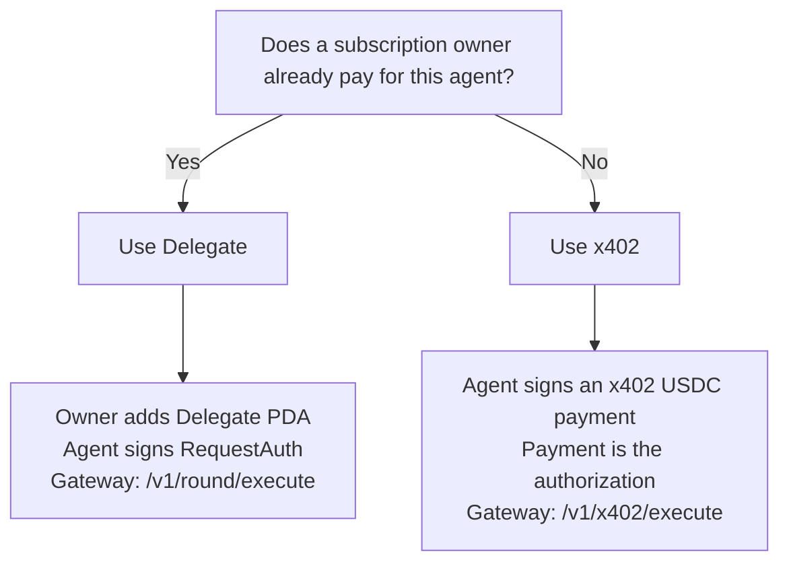

Molpha gives producers a monthly subscription and gives agents two practical ways to request verified data.

## Choose by workflow

| Access model | Best for | Who pays | What it buys |
| --- | --- | --- | --- |
| **Subscriptions** | Teams that publish and maintain feeds | Subscription owner | Monthly plan, delegates, gateway rounds counted against the subscription's round quota |
| **Delegate** | Autonomous agents under an existing subscription | Subscription owner (prepaid plan) | Hot agent key can request rounds under a request cap |
| **x402** | Agents paying per request with no monthly plan | The caller, per round | One round at the protocol price, paid with an x402 v2 USDC payment to the protocol treasury |

<Note>
**x402** is the HTTP payment loop (`402 Payment Required`). Each verified payment authorizes exactly one round. There is no escrow account: the payment goes straight to the protocol treasury.
</Note>

## Agents: pick one of two

| | **Delegate** | **x402** |
| --- | --- | --- |
| Requires subscription | Yes | No |
| On-chain account | `Delegate` `["molpha_delegate", owner, delegate]` | None |
| Who authorizes requests | Hot `delegate` pubkey, with `RequestAuth` (`authSig` + `authTimestamp`) or, where the gateway enables it, a sign-in session | The x402 payment itself; no `RequestAuth` |
| Paid by | Prepaid subscription | One USDC payment to the protocol treasury per round |
| Caps | `max_data_requests` per subscription term, enforced by the gateway | One payment authorizes one round |
| Gateway route | `POST /v1/round/execute` | `POST /v1/x402/execute` |

## Who needs one

Only callers that **request new rounds** need a subscription, a delegate or an x402 payment. Reading a Solana `Feed` account or verifying an attestation is free and needs none of them.

## Next steps

<CardGroup cols={3}>
  <Card title="Subscriptions" icon="calendar-check" href="/access-models/subscriptions">
    Monthly USDC plans and quota.
  </Card>
  <Card title="Delegates" icon="user-check" href="/access-models/delegates">
    Hot agent keys under a subscription.
  </Card>
  <Card title="x402 pay-per-request" icon="credit-card" href="/access-models/x402">
    One payment, one round.
  </Card>
</CardGroup>
