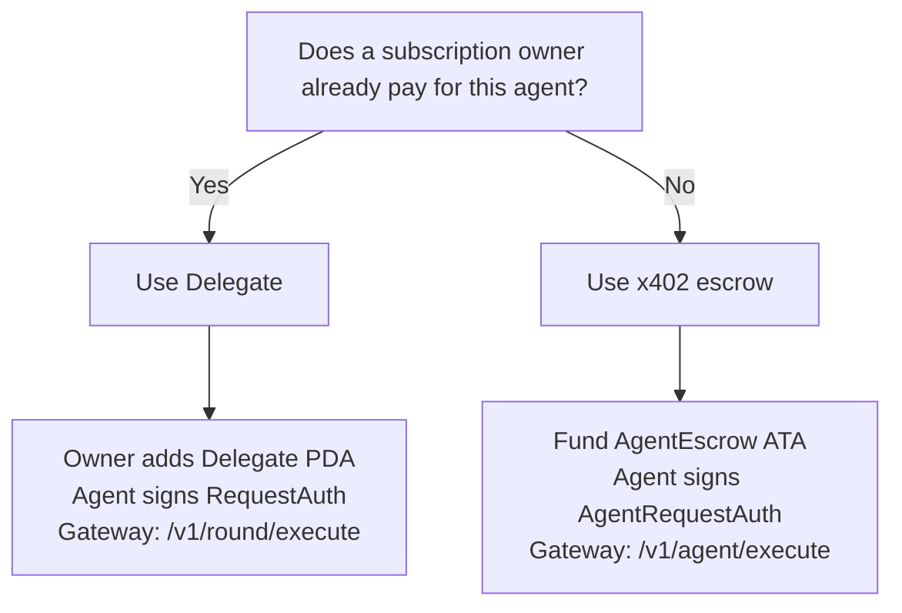

Brebeneskul gives producers a monthly subscription and gives agents two practical ways to request verified data.

## Choose by workflow

| Access model | Best for | Who pays | What it buys |
| --- | --- | --- | --- |
| **Subscriptions** | Teams that publish and maintain feeds | Subscription owner | Monthly plan, delegates, gateway rounds settled against the subscription |
| **Delegate** | Autonomous agents under an existing subscription | Subscription owner (prepaid plan) | Hot agent key can request rounds with request/quorum caps |
| **x402 escrow** | Agents paying per request with no monthly plan | Agent / escrow funder | One signed round at protocol price via funded `AgentEscrow` ATA |

<Note>
**x402** is the HTTP payment loop (`402 Payment Required`). **Agent escrow** is the on-chain USDC purse that x402 funds and settles. They are the same access path — not two alternatives.
</Note>

## Agents: pick one of two

| | **Delegate** | **x402 escrow** |
| --- | --- | --- |
| Requires subscription | Yes | No |
| On-chain account | `Delegate` `["molpha_delegate", owner, delegate]` | `AgentEscrow` `["molpha_agent", authority, gateway]` |
| Who signs requests | Hot `delegate` pubkey | Escrow `authority` (usually the payer) |
| Settled by | `settle_round_receipt` | `settle_agent_round` |
| Caps | `max_data_requests`, `max_signers`, pause | Escrow ATA balance + quoted `amount` |
| Gateway route | `POST /v1/round/execute` | `POST /v1/agent/execute` |

## Important distinction

- **Producers** use a subscription to own feed identity and keep feeds updated.
- **Consumers** can read public Solana `Feed` accounts or verify signed payloads without any of the models above.
- **Agents** that only need verified payloads should choose **Delegate** or **x402 escrow** — not both as separate products.

## Related pages

<CardGroup cols={2}>
  <Card title="Subscriptions" icon="calendar-check" href="/access-models/subscriptions">
    Monthly USDC plans for feed production.
  </Card>
  <Card title="Delegates" icon="user-check" href="/access-models/delegates">
    Hot agent keys under a subscription.
  </Card>
  <Card title="x402 escrow" icon="credit-card" href="/access-models/x402">
    Pay-per-request funding + AgentEscrow settlement.
  </Card>
  <Card title="Gateway API" icon="cloud" href="/protocol/gateway">
    `/v1/round/execute` and `/v1/agent/execute`.
  </Card>
</CardGroup>
