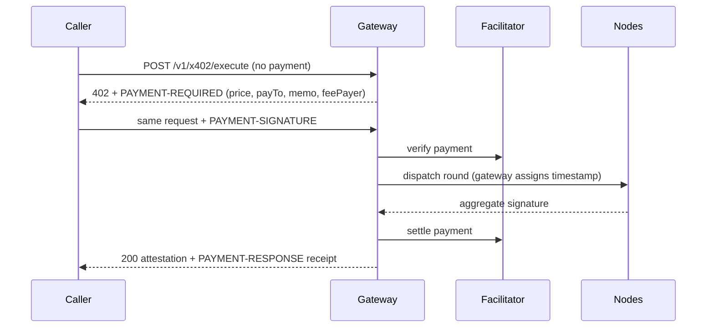

With **x402**, the caller pays for each round as it asks for it: one standard x402 v2 `exact` USDC payment on Solana authorizes exactly one round. There is no subscription, no escrow account and no request signature beyond the payment itself. It suits AI agents and one-off consumers.

The easiest way to use it is through MCP: [hosted](/mcp/hosted#pay-per-request-x402) or [local](/mcp/local). This page describes the protocol underneath.

## Flow



1. Send `POST /v1/x402/execute` with `signatures_required`, `registry_version` and `apiConfig`, without a payment header.
2. The gateway answers `402 Payment Required` with a base64 `PAYMENT-REQUIRED` header and the same object in the body. Its `accepts` entry gives the scheme `exact`, the Solana network, the amount, the USDC mint, `payTo`, `extra.feePayer` and `extra.memo`.
3. Sign a payment that matches that entry exactly and retry the same body with `PAYMENT-SIGNATURE: <base64 payment payload>`.
4. The gateway verifies the payment through its facilitator **before** dispatching the round, then settles it and returns the attestation with a `PAYMENT-RESPONSE` receipt.

Request and response schemas are in the [HTTP API reference](/gateways/api/x402-execute).

## Price and payee

```text
price = x402_round_base + (signatures_required + redundancy_buffer) × reward_per_signature
```

The amount is in USDC base units. `x402_round_base` and `reward_per_signature` come from the on-chain `ProtocolConfig`, and `redundancy_buffer` from the current registry, so the whole selected group is paid for. `GET /v1/x402/status` returns a quote.

`payTo` is the **protocol treasury**: the `ProtocolConfig` PDA, whose USDC token account receives the payment. It is never the gateway, and the gateway takes no fee. Treasury income is later swept into the epoch reward pool for nodes.

## Payment memo

`extra.memo` is the hex of:

```text
keccak256("MOLPHA_X402_REQUEST_V1" || program_id || gateway_pda || source_id
          || u8(signatures_required) || u32_be(registry_version))
```

It binds the payment to the program, the gateway, the source, the quorum and the registry version. It does not name a round, because the gateway assigns the round's timestamp only after it has verified the payment. Sign exactly the memo and fee payer the gateway advertised.

## Retries and failures

- **One payment, one round.** A payment is recorded once used; replaying it is rejected.
- **No idempotency key.** A retried request is a new round and needs a new payment once the first one has been used.
- **`409` costs nothing.** You already have a round for this source and quorum in the current 100 ms tick, or this payment already reserved a round. Nothing is reserved and an unused payment stays usable. Retry after one tick. See [round timing](/concepts/attestations#round-timing).
- **`503` at capacity costs nothing.** When the gateway is at capacity it refuses before reading the request.
- **A failed round is not charged, but the payment is used.** If the round reaches the nodes and fails, the payment is not settled, but the gateway will not accept it again. Sign a new payment to retry.
- **An unclear outcome is not a reason to pay again.** After an ambiguous `5xx` or a dropped connection, check your USDC account for the payment's memo before paying for the round again.

| Status | Meaning |
| --- | --- |
| `402` | Payment missing or rejected (inspect `PAYMENT-REQUIRED`), or the source itself is paywalled (`extensions.upstream`) |
| `400` | Invalid request, including a stale `registry_version` or an out-of-range quorum |
| `409` | Duplicate round in this tick, or payment already used for a round |
| `503` | Gateway at capacity, too few nodes accepted, round timeout, or payment outcome uncertain |

## Paywalled API sources

An API source can itself charge over x402. In that case the caller pays the source directly: request a quote with `x402Source`, then send one caller-signed authorization per eligible node in `sourcePayments`. Those payments go to the source, never to Molpha, and the round payment above is unchanged. Sources of an [integrated provider](/gateways/api/providers-list) are quoted the same way. Details are in the [HTTP API reference](/gateways/api/x402-execute).

## Trust

The gateway verifies and settles payments through a trusted x402 facilitator and never accepts a caller-supplied payer ID as evidence. A `200` response proves neither on-chain settlement nor a valid signature: verify the attestation before you use it.

To compare x402 with subscriptions and delegates, see [Access and payments](/access-models/overview).
