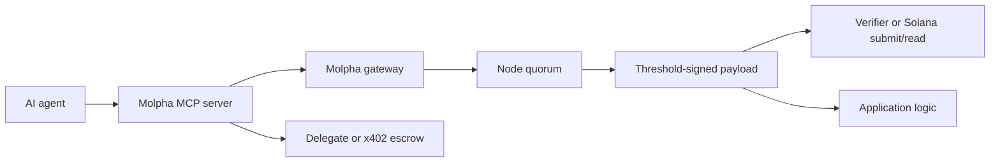

Molpha makes external data usable by agents without asking downstream systems to trust the agent's text output. The agent requests data, Molpha nodes sign the result, and applications verify the signed payload before acting.

## Why agents use Molpha

- **Typed tools, not prompt glue** — MCP exposes discover, derive, fetch (`payment: auto|subscription|x402`), verify, and execute operations as structured tools.
- **Portable trust anchor** — the signed payload can be verified by Solana, EVM, Starknet, or backend code.
- **Two agent payment options** — [Delegate](/access-models/delegates) under a subscription, or [x402 escrow](/access-models/x402) pay-per-request.
- **Separation of authority** — a cold subscription owner can authorize a hot agent key via Delegate without giving the agent the owner wallet.

## Agent access: pick one

| Option | When | Gateway |
| --- | --- | --- |
| **Delegate** | Subscription owner already pays; agent is a capped hot key | `POST /v1/round/execute` |
| **x402 escrow** | No subscription; agent funds USDC per round | `POST /v1/agent/execute` |

x402 (HTTP `402`) and `AgentEscrow` (on-chain ATA) are the same path — not a third option.

## Agent architecture

The agent may describe the value, but the application should treat the signed payload as the source of truth.

## Common workflows

| Workflow | Flow |
| --- | --- |
| Research agent | Discover feeds → request signed data → cite payload fields |
| Trading or prediction agent | Request signed market data → verify freshness → execute app policy |
| Subscription-backed automation | Owner adds Delegate → agent requests under caps → `settle_round_receipt` |
| One-off paid request | Fund x402 escrow ATA → agent pays per round → `settle_agent_round` |
| Smart contract assistant | Fetch payload → build EVM/Starknet args → wait for user confirmation |

## Safety model

Agents are powerful but forgetful; budget and write controls should live outside the prompt.

- Use MCP dry-run mode for exploration.
- Prefer **Delegate** caps (`max_data_requests`, `max_signers`) when a subscription exists.
- Prefer **x402 escrow** ATA balance limits when paying per request.
- Require explicit confirmation before submitting transactions.
- Verify payloads before acting on values.

## Start here

<CardGroup cols={2}>
  <Card title="Agent quickstart" icon="rocket" href="/quickstarts/ai-agents">
    First verified API request from an MCP client.
  </Card>
  <Card title="MCP server" icon="robot" href="/mcp/molpha-mcp">
    Tool reference, setup, signer adapters, and guardrails.
  </Card>
  <Card title="Delegates" icon="user-check" href="/access-models/delegates">
    Hot agent keys under a subscription.
  </Card>
  <Card title="x402 escrow" icon="credit-card" href="/access-models/x402">
    Pay per verified request via AgentEscrow.
  </Card>
</CardGroup>
