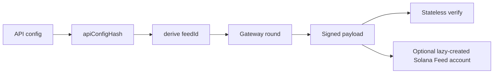

A Molpha feed answers one question:

> What exact value did the selected node quorum sign for this data source?

There is no separate feed-creation transaction. Feed identity is deterministic, and the Solana `Feed` account is created lazily the first time a signed update is written with `submit_data_update`. Gateway settlement writes payment receipts only — it does not create or update the `Feed`.

## Feed lifecycle



## Two consumption modes

| Mode | Use when | Trust check |
| --- | --- | --- |
| Read latest Solana `Feed` | You want low-latency access to the most recent maintained value | Validate the feed PDA and staleness |
| Verify payload directly | You need proof inside your own Rust program, service, or test | Use `molpha-verifier` and enforce freshness/replay policy |

## Feed identity

Feed identity is derived from the request authority, API config hash, and quorum:

```text
feedId = keccak256(
  "MOLPHA_JOB_V1" || owner || apiConfigHash || [signaturesRequired]
)
```

- `owner` is the subscription consumer authority for subscription-backed rounds.
- `owner` is the payer/authority for x402 agent rounds.
- `apiConfigHash` is `keccak256(JSON.stringify(canonicalizeAPIConfig(apiConfig)))`.
- `signaturesRequired` is a single byte.

The domain string still contains `JOB` for compatibility with the deployed program, but the public concept and SDK field are `feedId`.

```ts
import { deriveApiConfigHash, deriveFeedIdString } from "@molpha/sdk";

const apiConfigHash = deriveApiConfigHash(apiConfig);
const feedId = deriveFeedIdString(
  wallet.publicKey.toBytes(),
  apiConfigHash,
  signaturesRequired,
);
```

## Public data, private config

Only the `apiConfigHash` is stored on-chain. The full API config can remain off-chain, and private API secrets can be encrypted for selected nodes through the gateway.

## Solana `Feed` account

The Solana account is keyed by:

```text
["molpha_feed", feed_id]
```

It stores:

| Field | Meaning |
| --- | --- |
| `feed_id` | Derived feed identifier |
| `value` | Stored payload if ≤32 bytes, or keccak digest for longer payloads |
| `value_kind` | `Value` or `Hash` |
| `canonical_timestamp` | Monotonic update timestamp |
| `signatures_required` | Quorum threshold |
| `signers_bitmap` | Coalition bitmap |
| `registry_version` | Registry version used for verification |

Payloads up to 32 bytes are stored as-is. Payloads up to 256 bytes are hashed with keccak256 and stored as `FeedValueKind::Hash`.

## Values and decoding

The signed `value` is interpreted by the application that owns the feed schema.

- Values up to 32 bytes are stored directly.
- Longer values up to 256 bytes are stored as a keccak hash.
- Numeric feeds should document scale explicitly, for example `value / 10 ** 6`.
- Consumers should decode bytes only after verifying the payload or validating the Solana `Feed` PDA.

## API design checklist

Independent nodes must converge on a byte-identical value to co-sign it:

- Prefer settled, finalized data over live-drifting values.
- Avoid per-request timestamps, request IDs, and unstable ordering.
- Pin `responseParser` to the exact field you need.
- Include `valueTransform` in the config before deriving `feedId`.
- Reuse the exact same canonical config when requesting signed data.

## Related pages

<CardGroup cols={2}>
  <Card title="Payload schema" icon="brackets-curly" href="/reference/payload-schema">
    The portable artifact produced by each round.
  </Card>
  <Card title="SDK reference" icon="code" href="/sdk/reference">
    Derivation helpers and `DataUpdateResult` fields.
  </Card>
</CardGroup>
