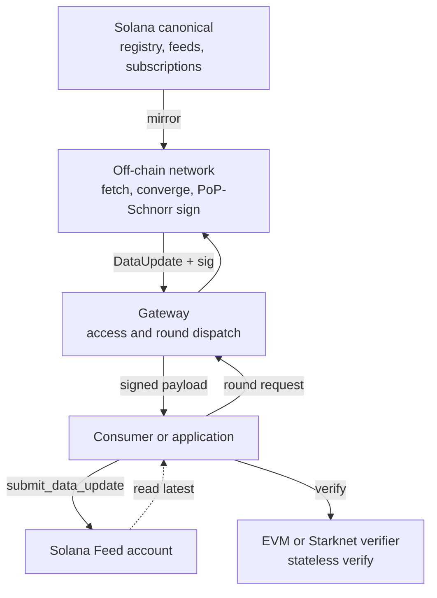

## The flow

## Step by step

1. **A feed is identified.** The feed commits to an off-chain API configuration via `apiConfigHash`; only the hash is stored on-chain. The feed identity is derived from `owner`, `apiConfigHash`, and `signaturesRequired`.
2. **Access is checked.** The request uses a subscription owner or [Delegate](/access-models/delegates), or [x402 escrow](/access-models/x402) pay-per-request.
3. **A round is requested.** A gateway round runs against the current on-chain registry version: a deterministically selected subset of nodes independently fetches the API, converges on a canonical value, and produces a single aggregate Schnorr signature.
4. **The result is a self-contained payload.** A `DataUpdate` (feedId, registryVersion, signaturesRequired, value, canonicalTimestamp) plus a `SchnorrSignature` (scalar `s`, commitment address, signers bitmap). The signers bitmap is bound into the signed message — the signer set cannot be chosen after the fact.
5. **Any chain verifies it.** Each verifier re-derives the eligible signer selection from the payload itself, reconstructs the coalition public key as the plain EC sum of the actual signers' keys, and checks one Schnorr signature. The same payload verifies on Solana, EVM, and Starknet.
6. **Consumption.** On Solana, `submit_data_update` writes the verified value to a `Feed` account anyone can read, or Rust consumers verify directly with `molpha-verifier`. On EVM and Starknet, your contract calls `verify()` and applies its own freshness policy.

## Key properties

- **Pull-native.** Rounds run on demand. There is no heartbeat to fund and no per-chain feed maintenance.
- **One signature, every chain.** No `chainId` in the signed message; identical domain-separated hashing on every verifier.
- **Agent-ready economics.** Brebeneskul adds x402 and escrow-based request payment without changing the payload that apps verify.
- **Selection is verifiable on-chain.** The eligible signer group is derived from `(feedId, registryVersion, canonicalTimestamp)` — a caller cannot grind a favorable signer set.
- **Verification is stateless on EVM/Starknet.** A successful `verify()` proves *who signed what*. Freshness, replay protection, and value bounds are the consumer's policy.
