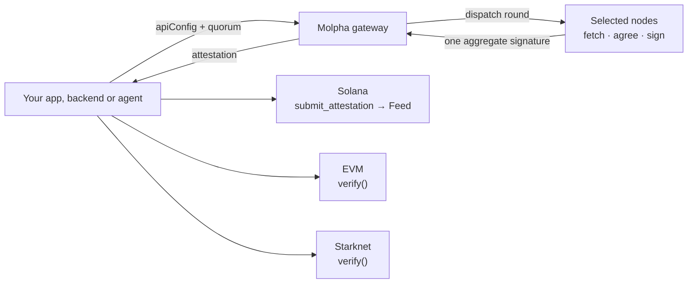

**Any API. One threshold signature. Every chain.**

Molpha turns an HTTP API response into an **attestation**: a value fetched by independent nodes, agreed on, and signed once with a single aggregate Schnorr signature. The same attestation verifies on Solana, on EVM chains and on Starknet, and an AI agent, backend or smart contract can check it without trusting whoever delivered it.

<CardGroup cols={3}>
  <Card icon="robot" href="/quickstarts/ai-agents" title="AI agents">
    Connect an agent to Molpha over MCP in minutes.
  </Card>
  <Card icon="server" href="/quickstarts/backend" title="Backends">
    Request and publish signed data with the TypeScript SDK.
  </Card>
  <Card icon="file-contract" href="/quickstarts/smart-contracts" title="Smart contracts">
    Verify an attestation on EVM, Solana or Starknet.
  </Card>
</CardGroup>

<Note>
Molpha currently runs on Solana devnet with verifiers on EVM and Starknet testnets, and the contracts are pre-audit. Don't secure real value with it yet. See [Deployments](/verifiers/deployments).
</Note>

## How it works

<Steps>
  <Step title="Define a source">
    Describe the API call and the value to extract. Its `sourceId` is the hash of that config, so there is nothing to register. See [Sources and feeds](/concepts/feeds).
  </Step>
  <Step title="Request a round">
    Pay with a [subscription](/access-models/subscriptions) or per request over [x402](/access-models/x402). The gateway stamps the round and dispatches it.
  </Step>
  <Step title="Nodes sign once">
    A deterministically selected group of registered nodes fetches the API independently, agrees on one value, and produces one aggregate signature. See [Rounds and attestations](/concepts/attestations).
  </Step>
  <Step title="Verify anywhere">
    Submit the attestation to a Solana `Feed` account, or call `verify()` on EVM or Starknet. Verifiers re-derive the signer selection and check one signature against the node set they mirror.
  </Step>
</Steps>

## Why it verifies everywhere

- **No `chainId` in the signed message.** Every verifier checks the same bytes, so the same attestation is valid on every supported chain, with no bridge and no per-chain feed.
- **The signer set is signed.** The bitmap of signers is part of the message and must fall inside the selection that verifiers re-derive themselves.
- **Stateless verification.** EVM and Starknet verifiers hold only a mirror of the node keys. Everything else arrives in calldata.
- **Solana is the canonical chain.** The node registry, deposits, subscriptions, rewards and `Feed` accounts live in the Molpha Solana program.

## What you get

| | |
| --- | --- |
| **Any HTTP API** | Prices, scores, statuses, documents: anything a public or private API returns. |
| **Pull-based** | Rounds run when you ask. No heartbeat to fund, no feed to wait for. |
| **Agent-ready** | An MCP server, hosted or local, with x402 pay-per-request and wallet sign-in. |
| **USDC pricing** | Subscriptions and per-request payments in USDC on Solana. No protocol token. |

Verification proves *who signed what*. Freshness, replay protection and which sources you accept stay your application's policy: see the [consumer checklist](/verifiers/overview#consumer-checklist).
