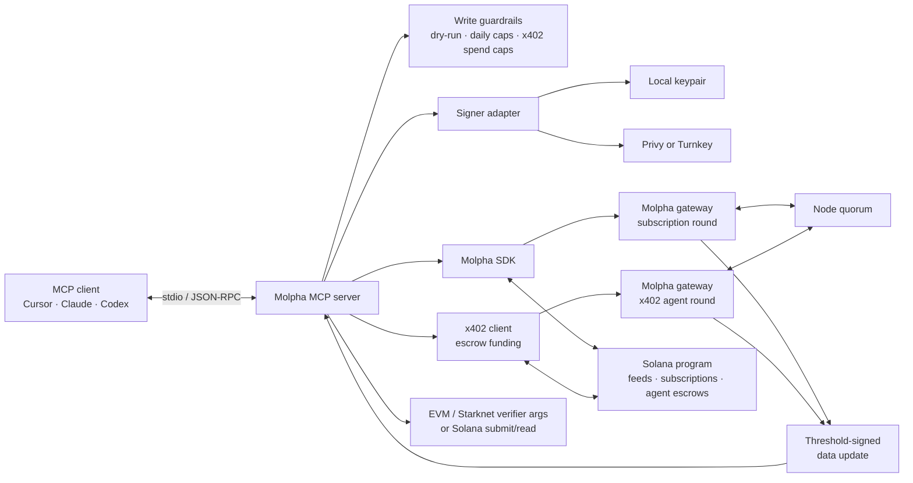

The Molpha MCP server gives AI agents a typed interface for discovering the network, deriving feeds, requesting threshold-signed payloads, verifying them, and publishing updates to Solana.

New here? Start with the [AI agent quickstart](/quickstarts/ai-agents) for the Brebeneskul setup path.

The server runs locally over [Model Context Protocol](https://modelcontextprotocol.io/) stdio and uses [`@molpha/sdk`](https://www.npmjs.com/package/@molpha/sdk) for gateway and on-chain operations. Package: [`@molpha/mcp`](https://www.npmjs.com/package/@molpha/mcp). Source: [`Molpha/mcp`](https://github.com/Molpha/mcp).

<Warning>
The current release targets Solana Devnet and Sepolia verifier networks. Write tools spend Devnet SOL and may consume subscription quota or x402 escrow funds unless dry-run mode is enabled.
</Warning>

## Tool reference

| Tool | Access | Purpose |
| --- | --- | --- |
| `molpha_get_capabilities` | Read | Discover the registry version, nodes, gateways, supported chains, verifier metadata, and x402 caps. |
| `molpha_derive_feed` | Read | Derive `feedId` from `apiConfig`, quorum, and signer. No transaction. |
| `molpha_describe_feed` | Read | Inspect feed state and caller subscription status. Pass `feedId`, or `apiConfig` + `signaturesRequired` to derive it. A missing account before first settle is normal. |
| `molpha_agent_status` | Read | Inspect x402 escrow balance, committed amount, and quoted next price. |
| `molpha_fetch_verified` | Read/quota/spend | Run a signing round and return the signed artifact plus verifier arguments. `payment` selects how the round is paid; `autoSubmit` can settle Solana in the same call. |
| `molpha_get_latest` | Read | Read the latest on-chain Solana feed. |
| `molpha_verify` | Read | Build EVM/Starknet verifier address and call arguments (calldata only, by design). |
| `molpha_execute` | Write | Submit a signed data update to Solana. Accepts the `molpha_fetch_verified` output unmodified. |

<Note>
EVM and Starknet execution is not performed by the MCP server. It returns verifier addresses and contract-ready arguments for those chains. Solana is the only leg this server settles — via `molpha_execute` or `molpha_fetch_verified` with `autoSubmit: true`. There is no standalone Solana verify-simulation path; submit, then read with `molpha_get_latest`.
</Note>

### `molpha_fetch_verified` payment

| Value | Behavior |
| --- | --- |
| `"auto"` (default) | Use the active subscription when present; otherwise fall back to `"x402"`. |
| `"subscription"` | Use the caller's active USDC subscription. Fails if inactive or out of quota. |
| `"x402"` | Self-fund the round from a per-signer escrow. The server can top up the escrow from the signer's USDC balance up to the x402 caps below. |

Set `autoSubmit: true` and include `"solana"` in `chains` to settle the Solana leg in the same call. `encryptSecrets` is not yet supported on the x402 path — use `payment: "subscription"` for feeds with encrypted secrets.

Call `molpha_agent_status` before x402 spend to inspect escrow balance, committed amount, and the quoted next price for a given quorum.

## Architecture



The MCP server is an adapter and policy boundary. The signed `DataUpdate` remains the trust anchor:

1. An MCP client invokes a typed tool over stdio.
2. The selected wallet signs gateway authentication messages and owner transactions.
3. Nodes independently fetch the feed's committed API configuration and aggregate a signature after reaching quorum.
4. The server returns the signed artifact and chain-specific verifier arguments.
5. A consumer verifies the payload against its registry version before using the value.

Subscription and extension operations are kept in a separate CLI because they debit USDC. Pay-per-request agent access uses the gateway's x402/escrow endpoints; see [Access Models](/access-models/overview).

## Setup

### Prerequisites

- Node.js 24 or later
- An MCP client such as Cursor, Claude Desktop, or Codex
- A Solana wallet funded with Devnet SOL
- Devnet USDC for subscription or x402 operations — use [Circle's faucet](https://faucet.circle.com/) (select **USDC** on **Solana Devnet**)

<Steps>
  <Step title="Clone and build">
    ```bash
    git clone https://github.com/Molpha/mcp.git
    cd mcp
    npm ci
    cp .env.example .env
    npm run build
    ```

    Or install the published package [`@molpha/mcp`](https://www.npmjs.com/package/@molpha/mcp) and point your client at its `molpha-mcp` binary.
  </Step>

  <Step title="Choose a signer">
    **Local keypair** (simplest for development):

    ```dotenv
    SIGNER_BACKEND=memory
    OWNER_KEYPAIR=/absolute/path/to/owner-keypair.json
    SOLANA_RPC=https://api.devnet.solana.com
    GATEWAY_ENDPOINTS=
    ```

    Leave `GATEWAY_ENDPOINTS` empty to use the SDK default (`https://dev-gateway.molpha.io`). See [Gateway API](/protocol/gateway).

    **Hosted signers** — set `SIGNER_BACKEND=keychain` and one of:

    | Backend | Required variables |
    | --- | --- |
    | Privy | `KEYCHAIN_BACKEND=privy`, `PRIVY_APP_ID`, `PRIVY_APP_SECRET`, `PRIVY_WALLET_ID`, `PRIVY_WALLET_ADDRESS` |
    | Turnkey | `KEYCHAIN_BACKEND=turnkey`, `TURNKEY_API_PUBLIC_KEY`, `TURNKEY_API_PRIVATE_KEY`, `TURNKEY_ORGANIZATION_ID`, `TURNKEY_WALLET_ADDRESS` |

    The same wallet must be used for provisioning and MCP runtime operations. Feeds are wallet-owned.
  </Step>

  <Step title="Validate the setup">
    ```bash
    npm run doctor
    ```

    The doctor validates the compiled server, signer, wallet, and Solana RPC, then prints client configuration snippets with absolute paths.
  </Step>

  <Step title="Bootstrap a subscription">
    Preview the transaction first, then subscribe with an explicit maximum USDC price:

    ```bash
    npm run provision -- subscribe --plan Basic --max-price-usdc 20000000 --dry-run
    npm run provision -- subscribe --plan Basic --max-price-usdc 20000000
    ```

    `20000000` is 20 USDC at 6 decimals. This is a safety cap; the transaction aborts if the on-chain price is higher.

    Skip this step if you only plan to use `payment: "x402"` or `"auto"` without a subscription.
  </Step>

  <Step title="Connect your MCP client">
    Point the client to the compiled stdio entry point, or install the Claude Desktop MCPB (see below).

    <Tabs>
      <Tab title="Cursor / Claude Desktop">
        ```json
        {
          "mcpServers": {
            "molpha": {
              "command": "node",
              "args": ["/absolute/path/to/mcp/dist/src/server.js"],
              "env": {
                "SIGNER_BACKEND": "memory",
                "OWNER_KEYPAIR": "/absolute/path/to/owner-keypair.json",
                "SOLANA_RPC": "https://api.devnet.solana.com"
              }
            }
          }
        }
        ```
      </Tab>
      <Tab title="Codex">
        ```toml
        [mcp_servers.molpha]
        command = "node"
        args = ["/absolute/path/to/mcp/dist/src/server.js"]

        [mcp_servers.molpha.env]
        SIGNER_BACKEND = "memory"
        OWNER_KEYPAIR = "/absolute/path/to/owner-keypair.json"
        SOLANA_RPC = "https://api.devnet.solana.com"
        ```
      </Tab>
      <Tab title="Claude Desktop (MCPB)">
        ```bash
        npm run build
        npx @anthropic-ai/mcpb pack . molpha-mcp.mcpb
        ```

        Install `molpha-mcp.mcpb` in Claude Desktop (double-click, drag into the window, or Settings → Extensions → Install Extension). Set the signer backend and related fields during install.
      </Tab>
    </Tabs>

    Restart the client after saving the configuration. Then ask it to call `molpha_get_capabilities`. If tool names look stale, restart or reload the MCP server so the client refreshes its tool list.
  </Step>
</Steps>

<Warning>
Never commit `.env`, wallet keypairs, Privy secrets, or Turnkey credentials. Prefer absolute paths in MCP configuration because clients may start the server from a different working directory.
</Warning>

## Example prompts

**Inspect the network**

> Use Molpha to inspect the current oracle capabilities. Summarize the registry version, node count, supported chains, gateway endpoints, and verifier addresses. Do not make any writes.

**Derive a feed**

> Derive a Molpha feedId for `https://api.example.com/v1/finalized/price` using the JSON path `$.price` and 3 required signatures. Show me the API config hash, the derived feedId, and any determinism warnings. Do not send a transaction.

Use an endpoint whose response is stable enough for independent nodes to reproduce. Fast-moving ticker APIs can return different values to different nodes and fail to reach quorum.

**Fetch and verify**

> For that same feed, fetch a signed result with `payment: "auto"` and a maximum age of 60 seconds, for the EVM chain. Summarize the signed value, timestamp, registry version, quorum, and EVM verifier call, and tell me whether it was paid for via subscription or x402. Treat the signed artifact as the trust anchor; do not trust the value by itself.

**Check x402 spend before paying**

> Call `molpha_agent_status` for 3 required signatures. Tell me the escrow's USDC balance, committed amount, and quoted next price before I authorize any x402 spend.

**Preview a Solana update**

> Read the latest value for Molpha feed `<FEED_ID>`. If I provide a newer signed result, preview `molpha_execute` with `dryRun: true`, explain the fee-paying wallet and exact write, and wait for my confirmation before submitting it to Solana.

## Guardrails

| Variable | Default | Effect |
| --- | --- | --- |
| `MOLPHA_DRY_RUN` | `false` | Preview every write and spend when set to `true`. |
| `MOLPHA_MAX_EXECUTES_PER_DAY` | `100` | Limit Solana submissions per process and UTC day. |
| `MOLPHA_X402_MAX_PRICE_USDC` | `1` | Refuse to fund an x402 round priced above this (decimal USDC). |
| `MOLPHA_X402_MAX_SPEND_PER_DAY_USDC` | `10` | Process-local daily x402 spend cap (decimal USDC). |
| `MOLPHA_X402_GATEWAY_PDA` | — | Optional: skip x402 discovery when the settling gateway PDA is known out of band. |

The counters reset when the MCP server restarts. Use durable policy and wallet controls in addition to these guardrails for higher-risk environments.

## Troubleshooting

<AccordionGroup>
  <Accordion title="The server appears to hang">
    `node dist/src/server.js` waits for JSON-RPC on stdin and normally prints nothing. Launch it through an MCP client, then call `molpha_get_capabilities`.
  </Accordion>

  <Accordion title="The MCP client cannot find the server">
    Run `npm run build`, use an absolute path to `dist/src/server.js`, and restart the client. `npm run doctor` prints a resolved configuration snippet.
  </Accordion>

  <Accordion title="The client still lists job tools like molpha_create_job">
    The running server is feed-based (`derive_feed`, `describe_feed`, `agent_status`). Restart or reload the MCP server so the client refreshes its tool descriptors.
  </Accordion>

  <Accordion title="A subscription-backed fetch reports an inactive subscription">
    Run the provisioning CLI with the same signer used by the MCP server, or use `payment: "x402"` / `"auto"` for a self-funded round.
  </Accordion>

  <Accordion title="Nodes do not reach quorum">
    Check that the endpoint returns deterministic, settled data. Every selected node must derive a byte-identical normalized value for the round to aggregate successfully.
  </Accordion>
</AccordionGroup>

## Next steps

<CardGroup cols={2}>
  <Card title="Agent quickstart" icon="rocket" href="/quickstarts/ai-agents">
    Derive a feed, fetch verified data, and optionally submit to Solana.
  </Card>
  <Card title="How Molpha works" icon="diagram-project" href="/getting-started/how-it-works">
    Follow a value from an HTTP response to a cross-chain aggregate signature.
  </Card>
  <Card title="Feeds" icon="list-check" href="/concepts/feeds">
    Learn how API configurations are committed and feeds are identified.
  </Card>
  <Card title="Verifier overview" icon="shield-check" href="/verifiers/overview">
    Understand verification across Solana, EVM, and Starknet.
  </Card>
</CardGroup>
