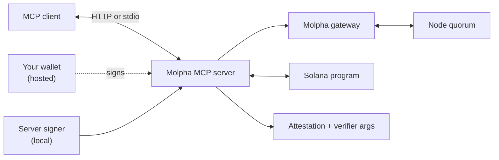

The Molpha MCP server lets an AI agent derive source IDs, run signing rounds, pay for them, publish results to Solana and build verifier calls for EVM and Starknet, all as structured tools instead of prompt glue. It speaks the [Model Context Protocol](https://modelcontextprotocol.io/) and works with Claude, Cursor, VS Code, Codex and other MCP clients.

## Choose an integration

|  | [Hosted: `mcp.molpha.io`](/mcp/hosted) | [Local: stdio](/mcp/local) |
| --- | --- | --- |
| Install | Nothing. Add the URL to your client. | `npx -y @molpha/mcp`, Node.js 24 or later |
| Who signs | Your own wallet. The server holds no key. | A signer the server holds: local keypair, Privy or Turnkey |
| Subscription rounds | Sign in with your wallet (SIWX), then run rounds | One call |
| x402 rounds | Prepare, sign the USDC transfer, execute | One call |
| Spending limits | Your wallet's own policy, plus the server's per-round x402 price cap | Dry-run lock plus per-round and daily caps |
| Private API secrets | Not supported | Supported on subscription rounds |
| Best for | Getting started; agents that bring their own wallet | Unattended agents; private API sources |

Both run the same server code and return the same signed artifacts.

## Tools at a glance

| Tool | What it does | Hosted | Local |
| --- | --- | :-: | :-: |
| `get_capabilities` | Network, registry, nodes, chains, verifier addresses, limits | ✓ | ✓ |
| `derive_source_id` | `sourceId` and canonical JSON for an `apiConfig` | ✓ | ✓ |
| `describe_feed`, `get_latest_value` | Read a Solana `Feed` account | ✓ | ✓ |
| `describe_access` | Is a wallet a subscription owner or delegate, and its limits | ✓ | ✓ |
| `get_x402_status` | x402 price quote, payee and the payer's USDC balance | ✓ | ✓ |
| `list_providers`, `get_provider`, `quote_source_payment` | Integrated data providers and paywalled sources | ✓ | ✓ |
| `build_verifier_calldata` | EVM or Starknet `verify()` arguments (builds calldata only; verifies nothing) | ✓ | ✓ |
| `execute_subscription_round` | Round paid from a subscription | after sign-in | ✓ |
| `execute_x402_round` | Round paid per request with x402 | after `prepare_x402_round` | ✓ |
| `submit_attestation` | Write an attestation to Solana | as `prepare_submit_attestation` + `send_signed_transaction` | ✓ |
| `begin_session`, `complete_session` | Sign in with your wallet (SIWX) | ✓ | — |

Inputs, outputs and error codes are in the [tool reference](/mcp/tools).

## How it fits together

The server is an adapter and a policy boundary, not a source of truth. Every round tool returns the signed attestation plus ready-made verifier arguments for each chain you ask for. Treat that attestation, not the agent's summary of it, as the trust anchor.

## Safety model

- **Every round spends.** There is no idempotency key: a repeated call after an unclear error is a new round. Read state (`describe_feed`, `get_x402_status`) before retrying.
- **Limits live outside the prompt.** On the hosted server, set a spending policy on your wallet. On a local server, use the dry-run lock and caps, which an agent cannot switch off from a conversation.
- **Untrusted payment terms are checked.** Before anything is signed, the server checks a gateway's `402` terms against what it derives itself: the protocol treasury as payee, the protocol USDC mint, the protocol price and the cluster.
- **Verify before acting.** `build_verifier_calldata` builds arguments only. Your contract or service calls `verify()`.
