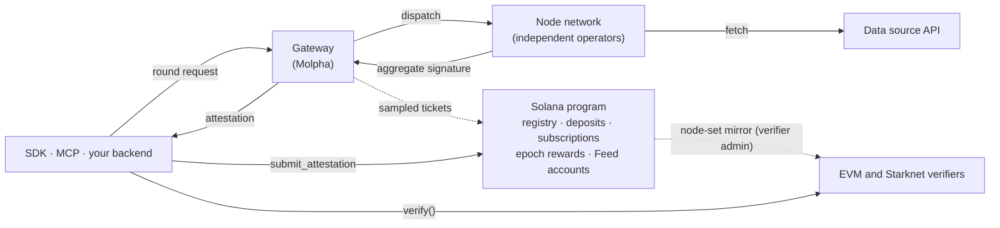

This page maps Molpha's components and the invariants that let one signed attestation verify on every chain. Read it before you design an integration or review the trust model.

## Components

| Component | Operated by | Role |
| --- | --- | --- |
| Node network | Independent node operators, registered by the protocol authority | Fetch the source; a deterministically selected subset signs each round with secp256k1 keys |
| Gateways | Molpha | Admit requests, enforce payment and quota, stamp the round timestamp, dispatch rounds to nodes, return the `Attestation`, and submit sampled rounds as epoch tickets. See [Gateways](/gateways/overview) |
| Solana program | On-chain | Versioned node registry, node deposits and punishments, gateways, plans and subscriptions, epoch rewards, and `Feed` accounts written by permissionless `submit_attestation`. See [Solana program](/protocol/solana-program) |
| EVM and Starknet verifiers | On-chain | Stateless: a mirror of the node key set plus `verify(attestation, maxAge)`. See [Verifiers](/verifiers/overview) |
| SDK and MCP | Client side | [`@molpha/sdk`](https://www.npmjs.com/package/@molpha/sdk) wraps the gateway and the Solana program and builds EVM and Starknet arguments. `@molpha/mcp` exposes the same flows to agents |

A gateway response proves nothing by itself. Treat it as unverified until you verify the attestation on your chain or with `molpha-verifier`.

## Design invariants

1. **Stateless verification on EVM and Starknet.** `verify()` holds no feed, round or reward state; everything arrives in calldata. One signed payload is valid on every chain at once.
2. **No `chainId` in the signed message.** One signing round serves every chain.
3. **The signature commits to the signer set.** `signersBitmap` is inside the signed message.
4. **Selection is derivable on-chain.** The eligible group comes from `(sourceId, registryVersion, timestamp / 1000)`, the quorum and the snapshot's redundancy buffer. Verifiers re-derive it and never take it from the caller.
5. **Registry snapshots fix their key sets.** A signature is checked against the snapshot its payload names. A superseded snapshot stays acceptable only for a grace period. See [Registry versions](/concepts/registry-versions).
6. **Plain-sum aggregation with proof of possession.** No delinearization coefficients and no precomputed global key; rogue-key safety comes from proof of possession at registration.
7. **Replay and freshness belong to the consumer.** Verifiers check signatures, not usage. See the [consumer checklist](/verifiers/overview#consumer-checklist).

The math behind invariants 3, 4 and 6 is in [Cryptography](/protocol/cryptography).

## Next steps

<CardGroup cols={3}>
  <Card title="Cryptography" href="/protocol/cryptography">Selection, proof of possession and the verification pipeline.</Card>
  <Card title="Solana program" href="/protocol/solana-program">Accounts, instructions, epochs and slashing.</Card>
  <Card title="Security model" href="/protocol/security-model">What verification proves and who you trust.</Card>
</CardGroup>
